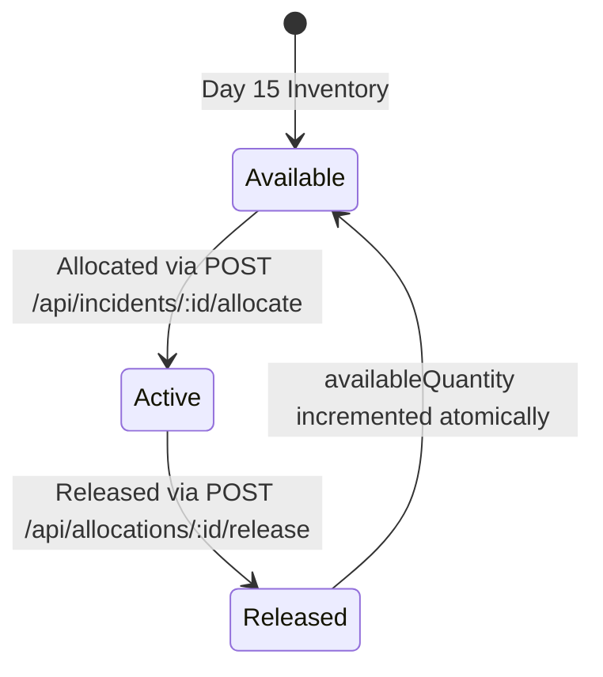

# CrisisAI — Day 16: Resource Allocation Engine Documentation

## 1. Overview & Objective

The **Resource Allocation Engine** bridges verified disaster incidents with the database-backed emergency inventory established in Day 15. It deterministically ranks, selects, atomically allocates, and safely releases resources while enforcing strict mathematical and operational invariants.

---

## 2. Resource Type Compatibility Mapping

To maintain full backward compatibility between incident extraction requirements (`REQUIRED_RESOURCES`) and emergency inventory (`RESOURCE_TYPES`), the allocation engine defines explicit, deterministic compatibility mappings:

| Incident Requirement | Primary Match | Compatible Alternatives |
|---|---|---|
| `ambulance` | `ambulance` | `medical_team` |
| `medical_team` | `medical_team` | `ambulance` |
| `fire_rescue` | `fire_rescue` | `fire_truck` |
| `search_rescue` | `search_rescue` | `rescue_boat`, `drone`, `heavy_machinery` |
| `food` | `food` | `food_water_supply`, `drinking_water` |
| `drinking_water` | `drinking_water` | `food_water_supply`, `food` |
| `shelter` | `shelter` | `shelter_kit` |
| `rescue_boat` | `rescue_boat` | `search_rescue` |
| `police` | `police` | `evacuation_team` |
| `evacuation_team` | `evacuation_team` | `evacuation_bus`, `police` |

**Priority Rule**: Exact matches always receive highest rank and are evaluated first (`suitability = 35 pts`) before compatible alternatives (`suitability = 25 pts`).

---

## 3. Allocation & Candidate Ranking Algorithm (`resourceRanking.js`)

Candidate resources are filtered by `status: 'available'` and `availableQuantity > 0`, then evaluated across 4 explainable criteria (Max 100 points):

1. **Suitability Match (0–35 pts)**:
   - Exact type match: **35 pts**
   - Compatible type alternative: **25 pts**
   - Unspecified / general incident need: **20 pts**
   - Secondary / fallback type: **5 pts**

2. **Distance & Proximity (5–25 pts)**:
   - Calculated via Haversine distance from incident coordinates to resource coordinates.
   - 0 km: **25 pts**, linearly scaled: $\max(5, 25 - (\text{distanceKm} \times 0.4))$.
   - Missing coordinates fallback: **15 pts** (neutral).

3. **Incident Priority Weight (0–25 pts)**:
   - Scales with incident calculated priority score: $(\text{priorityScore} / 100) \times 25$.

4. **Incident Urgency Factor (4–15 pts)**:
   - `immediate`: **15 pts**
   - `urgent`: **11 pts**
   - `soon`: **7 pts**
   - `routine`: **4 pts**

**Selection Order**: Candidates are sorted by `score` (descending), then `availableQuantity` (descending), then `_id` (deterministic tie-breaker).

---

## 4. Concurrency, Atomicity & Rollback Strategy

### Inventory Invariants
1. $0 \le \text{availableQuantity} \le \text{quantity}$
2. `quantity` (total capacity) remains strictly invariant during allocation and release.
3. Over-allocation is strictly prohibited at the atomic database level.

### Atomic Conditional Execution
Each decrement uses conditional atomic updates:
```javascript
const updated = await Resource.findOneAndUpdate(
  {
    _id: resourceId,
    availableQuantity: { $gte: requestedQty },
    status: 'available'
  },
  { $inc: { availableQuantity: -requestedQty } },
  { returnDocument: 'after' }
);
```

### Multi-Resource Rollback
If a multi-resource batch allocation encounters a race condition or partial failure partway through:
1. All previously decremented quantities in that batch are immediately restored via `$inc: { availableQuantity: prevQuantity }`.
2. Any newly created allocation documents in that batch are purged.
3. A structured shortage report is returned to the caller.

---

## 5. Allocation & Release Lifecycle



### Double-Release Prevention
The release endpoint atomically checks that `status === 'active'` before transitioning to `'released'`:
```javascript
const updated = await ResourceAllocation.findOneAndUpdate(
  { _id: allocationId, status: 'active' },
  { status: 'released', releasedBy: userId, releasedAt: new Date() },
  { returnDocument: 'after' }
);
```
If an allocation was already released, the atomic filter matches zero documents, preventing double inventory restoration.

### Idempotency
Clients can provide an optional `idempotencyKey`. Repeated requests with the identical idempotency key return the existing active allocation record without decrementing inventory twice.

---

## 6. API Endpoints

### 1. `POST /api/incidents/:id/allocate`
- **Auth**: `authority` or `admin`
- **Request Body**:
  ```json
  {
    "items": [
      { "resourceId": "6ac8e9c8...", "quantity": 2 },
      { "type": "food", "quantity": 10 }
    ],
    "idempotencyKey": "unique-client-key-123",
    "notes": "Urgent evacuation deployment"
  }
  ```
- **Response (201 Created / 200 OK)**:
  ```json
  {
    "success": true,
    "incidentId": "6ac8e9c8...",
    "allocations": [ ... ],
    "shortages": [ ... ],
    "fullyFulfilled": true,
    "message": "All requested resources allocated successfully."
  }
  ```

### 2. `GET /api/incidents/:id/allocations`
- **Auth**: Authenticated
- **Response**: List of all allocations for the incident populated with resource, creator, and release metadata.

### 3. `GET /api/incidents/:id/candidates`
- **Auth**: Authenticated
- **Response**: Ranked candidate resources with explainable scoring breakdown (`suitability`, `distance`, `incidentPriority`, `urgency`).

### 4. `POST /api/allocations/:allocationId/release`
- **Auth**: `authority` or `admin`
- **Response (200 OK)**:
  ```json
  {
    "success": true,
    "message": "Allocation released and inventory restored successfully.",
    "data": { ... }
  }
  ```

---

## 7. Verification & Test Results

The Day 16 test suite (`server/test_day16.js`) executes 47 comprehensive assertions:
- **Day 16 Allocation Suite**: 47 / 47 Passed ✅
- **Day 15 Inventory Regression**: 40 / 40 Passed ✅
- **Day 14 Geo+Time Duplicate Regression**: 47 / 47 Passed ✅
- **Frontend Production Build**: Vite built in 738ms ✅
